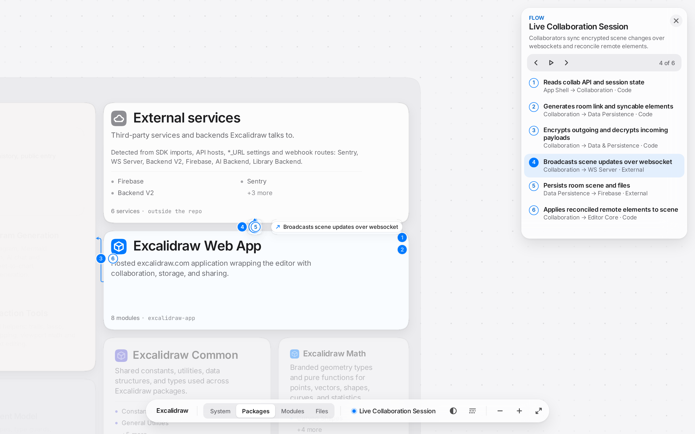

# Loupe

**Zoomable architecture maps for codebases and multi-repo systems — one self-contained offline HTML file.**

**[Live interactive demo →](https://arjanj.github.io/loupe/)**


## Quickstart

```sh
cd your-app
npx @arjanj/loupe
```

That scans your repository, groups files into modules, writes plain-English descriptions, traces typed connections and end-to-end flows, renders `architecture.html`, and opens it in your browser.

<table>
<tr>
<td></td>
<td></td>
</tr>
<tr>
<td></td>
<td></td>
</tr>
</table>

You can also download [`demo/excalidraw/excalidraw.html`](demo/excalidraw/excalidraw.html) ([Excalidraw](https://github.com/excalidraw/excalidraw)) or [`examples/bramble/bramble.html`](examples/bramble/bramble.html) (a fictional multi-repo system) and open either directly from disk — no server, no network.

## Requirements and cost

- **Runtime:** Node 18+ and `git` (run inside a git repository with at least one commit).
- **Model:** one of [Claude Code](https://docs.anthropic.com/en/docs/claude-code) (`claude` on your `PATH`), `ANTHROPIC_API_KEY`, or `OPENAI_API_KEY`. Loupe sends source excerpts and file paths to the model you choose.
- **Cost & caching:** model usage scales with repository size (small repos take seconds; a ~500-file monorepo takes longer on the first run). Answers are cached in `.loupe/cache/` keyed by prompt and code content, so reruns only pay for what changed.
- **Supported languages:** TypeScript, JavaScript, Python, Go, Rust, Ruby, Java, Kotlin, Swift, PHP, C#, C/C++, Objective-C, Scala, Elixir, Vue, Svelte, SQL, and Prisma. Static import/HTTP/DB/queue/external detectors currently focus on JS/TS/Prisma/SQL.

## How to read a map

- **Scroll or pinch** to zoom. Drag to pan. **Double-click** a card to fly into it.
- **Hover** a card to light up what it talks to. **Click** it to open the inspector with every connection and `file:line` evidence.
- **Esc** or a breadcrumb steps back out; the level switcher jumps to System, Packages, Modules, or Files.
- **Flows** plays a guided tour. **Legend** explains line styles. **◐** cycles System, Light, and Dark appearance.

## Usage

In a terminal without `--backend`/`--model` (or `LOUPE_BACKEND`/`LOUPE_MODEL`), Loupe lets you pick from the models available on your machine and remembers your choice per repo in `.loupe/config.json`. It never prompts in CI or non-interactive shells, where it picks the first available of `claude`, `ANTHROPIC_API_KEY`, or `OPENAI_API_KEY`.

```sh
npx @arjanj/loupe [map] [repoDir] [options]   # repoDir defaults to the current directory
  --out <file>        write the map somewhere else (default: <repoDir>/architecture.html)
  --no-open           don't open the browser (also off in CI, LOUPE_NO_OPEN, or non-TTY)
  --backend <name>    claude | anthropic | openai
  --model <name>      claude alias (sonnet, opus, haiku) or API model id
  --verbose           show every model call
```

Loupe writes `.loupe/.gitignore` so `.loupe/` stays out of git.

### Step by step

Run each stage separately to control file paths or build a multi-repo manifest map:

```sh
node bin/loupe.mjs scan input/your-app maps/your-app.tree.json        # structure + descriptions
node bin/loupe.mjs relations input/your-app maps/your-app.tree.json   # typed connections + flows
node bin/loupe.mjs render maps/your-app.tree.json                     # -> maps/your-app.html

# multi-repo system from a YAML manifest (no model needed)
node bin/loupe.mjs manifest examples/bramble/manifest.yaml
node bin/loupe.mjs render examples/bramble/manifest.tree.json
```

`scan` and `relations` accept `--backend` and `--model` too, caching answers in `.loupe-cache/` next to the output.

| Variable | Default | Meaning |
| --- | --- | --- |
| `LOUPE_BACKEND` | automatic | `claude`, `anthropic`, or `openai` (same as `--backend`) |
| `ANTHROPIC_API_KEY` | unset | enables the `anthropic` backend |
| `OPENAI_API_KEY` | unset | enables the `openai` backend |
| `ANTHROPIC_BASE_URL` | `https://api.anthropic.com` | API base URL for proxies/gateways |
| `OPENAI_BASE_URL` | `https://api.openai.com/v1` | API base URL for proxies/OpenAI-compatible servers |
| `LOUPE_CLAUDE_BIN` | `claude` | path to the Claude Code CLI |
| `LOUPE_MODEL` | `claude`: CLI default; `anthropic`: `claude-opus-5-5`; `openai`: `gpt-4.1` | model id or alias (`--model` wins) |
| `LOUPE_EFFORT` | backend default | `low`, `medium`, `high`, `xhigh`, or `max` |
| `LOUPE_CONCURRENCY` | `6` | parallel model calls |
| `LOUPE_KEY_FILES` | `12` | files described per module; the rest fold into `+N more` |
| `LOUPE_IGNORE` | none | regex of paths to skip (e.g. `^(examples\|docs)/`) |
| `LOUPE_CACHE` | `map`: `<repo>/.loupe/cache`; `scan`/`relations`: `<out dir>/.loupe-cache` | answer cache directory |
| `LOUPE_NOLLM` | unset | `relations` only: use cached answers, skip new model calls |
| `LOUPE_NO_OPEN` | unset | never open the browser |
| `LOUPE_VERBOSE` | unset | same as `--verbose` |

## What Loupe detects

`loupe relations` analyses code statically before asking the model to label rolled-up links and propose end-to-end flows:

- **Code:** runtime imports across files, workspace packages, and `@/` aliases (skipping type-only imports).
- **HTTP:** Express, Fastify, Hono, Koa, and Next.js routes matched to `fetch`/`axios`/`ky` callers.
- **Data:** Prisma model reads/writes and Drizzle table access.
- **Async:** BullMQ, pg-boss, Inngest, pub/sub, and web workers.
- **External & webhooks:** common SDKs (GitHub, Stripe, Slack, OpenAI, Anthropic, AWS, GCP, Firebase, Supabase, Sentry, etc.), literal API hosts, `*_URL` backends, and `/webhook(s)` routes.

## Multi-repo systems

Describe systems spanning multiple repositories in a [system manifest](docs/manifest.md): services, datastores, external systems, shared libraries, calls, flows, lifecycle status (`built`, `branch`, `proposed`, `planned`), and optional per-repo drill-down trees. See [`examples/bramble/manifest.yaml`](examples/bramble/manifest.yaml).

## Security & privacy

- **Your model only:** nothing leaves your machine except source excerpts and paths sent to the backend you configured. When using the `claude` backend, Loupe runs it headless in an empty temp directory with tools, MCP servers, and customizations disabled (`--tools ""`, `--strict-mcp-config`, and `--safe-mode` when supported). API keys are never logged and are redacted from errors.
- **Best-effort secret protection:** Loupe skips untracked files, ignores common secret filenames (`.env*`, `*secret*`, `*credential*`, `*.pem`, `private_key`), and redacts URL credentials, query strings, Slack webhooks, and common token patterns from evidence snippets. Still, rendered maps embed file paths, short code snippets, and generated descriptions — **treat a map of a private repository as private**.
- **Offline viewer with CSP:** every rendered HTML map embeds its own fonts and enforces a strict Content Security Policy (`default-src 'none'` with SHA-256 script hashes) so it makes zero network requests.

To report a security issue, see [SECURITY.md](SECURITY.md).

## Development & tests

See [CONTRIBUTING.md](CONTRIBUTING.md) for local setup, running the Playwright test suite (`npm test`), and PR conventions.

## License

MIT © 2026 Arjan Jassal. Embedded fonts are under the SIL Open Font License 1.1. The Excalidraw demo is generated from [Excalidraw](https://github.com/excalidraw/excalidraw) (MIT) and is not affiliated with that project. See [THIRD_PARTY_NOTICES.md](THIRD_PARTY_NOTICES.md).
