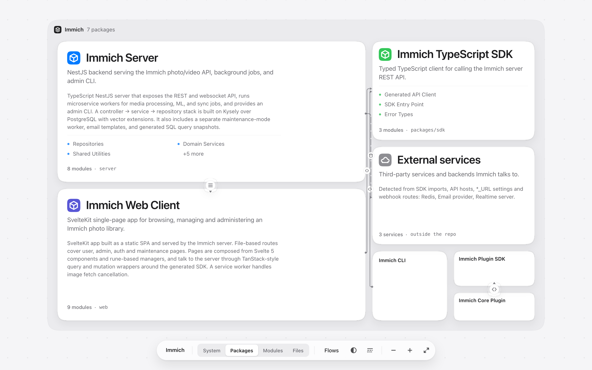

# Loupe

Loupe turns a codebase into a zoomable architecture map: a single HTML file you can open offline.

**[Live demo](https://arjanj.github.io/loupe/demos/immich.html)**



## Quickstart

```sh
cd your-app
npx @arjanj/loupe
```

Loupe scans the repo, groups files into modules, describes them, maps how they connect, and writes `loupe.html`, which it then opens in your browser.

## Requirements

- Node 18+ and a git repository with at least one commit.
- One model backend: [Claude Code](https://docs.anthropic.com/en/docs/claude-code) (`claude` on your `PATH`), `ANTHROPIC_API_KEY`, or `OPENAI_API_KEY`.

Loupe sends source excerpts and file paths to the backend you pick. Answers are cached in `.loupe/cache/`, so a rerun only pays for files that changed.

## Reading a map

- Scroll or pinch to zoom, drag to pan, double-click a card to zoom into it.
- Hover a card to highlight its connections. Click it to see each connection with `file:line` evidence.
- Press Esc or use the breadcrumbs to zoom back out.
- **Flows** plays a guided tour of the main paths through the code.

## Options

```sh
npx @arjanj/loupe [repoDir] [options]
  --out <file>        output path (default: <repoDir>/loupe.html)
  --no-open           don't open the browser
  --backend <name>    claude | anthropic | openai
  --model <name>      model alias (sonnet, opus, haiku) or API model id
  --verbose           log every model call
```

If you don't pass `--backend`, Loupe asks which one to use and remembers your choice in `.loupe/config.json`. In CI it uses the first one it finds.

Useful environment variables:

| Variable | Default | Meaning |
| --- | --- | --- |
| `LOUPE_IGNORE` | none | regex of paths to skip, e.g. `^(examples\|docs)/` |
| `LOUPE_CONCURRENCY` | `6` | parallel model calls |
| `LOUPE_EFFORT` | backend default | `low`, `medium`, `high`, `xhigh`, or `max` |
| `ANTHROPIC_BASE_URL` / `OPENAI_BASE_URL` | official APIs | point at a proxy or compatible server (https, or http on localhost) |
| `LOUPE_ALLOW_HTTP` | off | `1` allows a plain `http://` base URL on a network you trust |
| `LOUPE_CLAUDE_BIN` | `claude` | path to the Claude Code CLI |

## Multi-repo systems

To map a system that spans several repos, describe it in a YAML [manifest](docs/manifest.md) and render it. No model is needed for this.

```sh
npx @arjanj/loupe manifest examples/bramble/manifest.yaml
npx @arjanj/loupe render examples/bramble/manifest.tree.json
```

See [`examples/bramble/manifest.yaml`](examples/bramble/manifest.yaml) for a full example.

## Privacy

- Code only goes to the model backend you choose. The rendered map makes no network requests.
- Loupe skips untracked files and common secret files (`.env*`, `*.pem`, and so on), and redacts tokens it finds in code snippets.
- A map includes file paths and short code snippets, so treat a map of a private repo as private.

Report security issues via [SECURITY.md](SECURITY.md).

## Contributing

See [CONTRIBUTING.md](CONTRIBUTING.md). Run the tests with `npm test`.

## License

MIT. See [THIRD_PARTY_NOTICES.md](THIRD_PARTY_NOTICES.md) for bundled fonts and the Immich demo.
