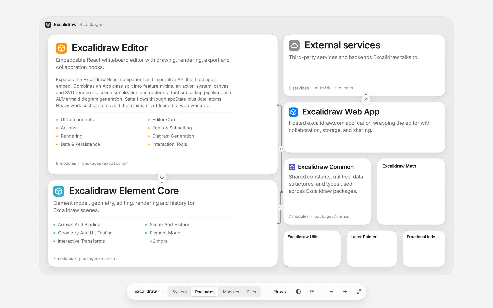

# Loupe

**Zoomable architecture maps for codebases and multi-repo systems.**

Loupe turns a repository, or a whole system of repos, into one self-contained HTML file. You can zoom from "what is this system" down to a single file. Cards open as you zoom in: the system shows its packages, packages show their modules, and modules show their files. Each level explains itself in plain sentences. Typed connections show how the parts talk to each other: HTTP, async jobs, data, third-party APIs, webhooks and code imports. Every connection links to the line of source that proves it. Guided flows walk through the main things the system does, step by step.



<table>
<tr>
<td></td>
<td></td>
</tr>
<tr>
<td></td>
<td></td>
</tr>
</table>

Try it: open [`demo/excalidraw/excalidraw.html`](demo/excalidraw/excalidraw.html), a map of [Excalidraw](https://github.com/excalidraw/excalidraw), or [`examples/bramble/bramble.html`](examples/bramble/bramble.html), a fictional multi-repo system. Download either file and open it in a browser; it needs no server and no network.

## How to read a map

- **Scroll or pinch** to zoom. Drag to pan. **Double-click** a card to fly into it.
- **Hover** a card to light up what it talks to. **Click** it to open the inspector, which lists every connection with its evidence.
- **Esc** or a breadcrumb takes you back out. The level switcher jumps straight to System, Packages, Modules or Files.
- **Flows** plays a guided tour. **Legend** explains the line styles. The **◐** button cycles between System, Light and Dark appearance.

## Quickstart

Requires Node 18 or later. `loupe scan` also needs [Claude Code](https://docs.anthropic.com/en/docs/claude-code) installed and signed in (the `claude` CLI). Loupe runs Claude Code headless, with tools disabled, to group files into modules and write the descriptions.

```sh
git clone https://github.com/ArjanJ/loupe && cd loupe && npm install

# a single repo (a monorepo with npm/yarn/pnpm workspaces, or a plain package)
git clone --depth 1 https://github.com/you/your-app input/your-app
node bin/loupe.mjs scan input/your-app maps/your-app.tree.json        # structure + descriptions (Claude Code)
node bin/loupe.mjs relations input/your-app maps/your-app.tree.json   # typed connections + flows
node bin/loupe.mjs render maps/your-app.tree.json                     # -> maps/your-app.html

# a system of many repos, from a YAML manifest (no LLM needed)
node bin/loupe.mjs manifest examples/bramble/manifest.yaml
node bin/loupe.mjs render examples/bramble/manifest.tree.json
```

Answers from Claude Code are cached in `.loupe-cache/` next to the output, so a rerun costs nothing unless the code changed. The first scan of a mid-size monorepo (around 500 source files) takes tens of minutes.

| Variable | Default | Meaning |
| --- | --- | --- |
| `LOUPE_CLAUDE_BIN` | `claude` | path to the Claude Code CLI |
| `LOUPE_MODEL`, `LOUPE_EFFORT` | CLI defaults | passed as `--model` / `--effort` |
| `LOUPE_CONCURRENCY` | `6` | parallel Claude Code calls |
| `LOUPE_KEY_FILES` | `12` | files described per module; the rest become "+N more" |
| `LOUPE_IGNORE` | none | regex of paths to leave out, e.g. `^(examples\|docs)/` |
| `LOUPE_CACHE` | `<output dir>/.loupe-cache` | answer cache |
| `LOUPE_NOLLM` | unset | `relations` only: use cached answers, skip new LLM calls |

## What Loupe detects

`loupe relations` reads the code statically; no LLM is involved in finding connections.

- **Code:** runtime imports between files, including workspace packages and `@/` aliases. Type-only imports are skipped.
- **HTTP:** Express, Fastify, Hono and Koa-style routes, plus Next.js route handlers and `pages/api`. These are matched to the `fetch`/`axios`/`ky` calls that hit them.
- **Data:** Prisma model reads and writes, and Drizzle table access.
- **Async:** BullMQ, pg-boss and Inngest producers and consumers, paired by queue or event name. Also web workers.
- **External:** well-known SDKs (GitHub, Stripe, Slack, OpenAI, Anthropic, AWS, Google Cloud, Firebase, Supabase, Sentry and more), literal API hosts, and backends configured by `*_URL` environment variables.
- **Webhooks:** routes under `/webhook(s)`.

Claude Code then labels the rolled-up connections ("renders the scene") and proposes a few end-to-end flows. Loupe checks each flow step against the connections it detected.

## Multi-repo systems

When a system spans many repos, describe it in a [system manifest](docs/manifest.md): services, datastores, external systems, shared libraries, the calls between them, and flows. Each item can carry a lifecycle status (built, branch, proposed, planned) and a confidence level. The map draws work that isn't built yet as ghosted, dashed cards and edges, and tags inferred facts. A service can also drill down into a full per-repo map. See [`examples/bramble/manifest.yaml`](examples/bramble/manifest.yaml).

## Privacy

Everything runs on your machine. `scan` sends source excerpts to Claude through your own Claude Code CLI; nothing else leaves your machine. A rendered map embeds file paths, short code snippets as evidence, and the generated descriptions. Treat a map of a private repo as private: `input/`, `.loupe-cache/` and `private/` are gitignored here for that reason.

## Repository layout

| Path | What |
| --- | --- |
| `bin/loupe.mjs` | the CLI: `scan`, `relations`, `manifest`, `render` |
| `src/` | generator, relationship analysis, manifest converter, renderer |
| `viewer/template.html` | the viewer: vanilla Canvas 2D, no dependencies |
| `viewer/fonts/` | Inter and JetBrains Mono subsets (SIL OFL 1.1), embedded at render time |
| `docs/` | [manifest schema](docs/manifest.md), [tree format](docs/tree-format.md), screenshots |
| `examples/bramble/` | a fictional multi-repo system |
| `demo/excalidraw/` | a map of Excalidraw (MIT), generated by Loupe |
| `test/` | browser acceptance checks, an escaping test, the screenshot script (need Playwright) |

## Tests

```sh
npm i -D playwright && npx playwright install chromium
npm test                                                   # escaping + acceptance on the example
SCHEME=dark node test/acceptance.mjs demo/excalidraw/excalidraw.html
npm run screenshots
```

## License

MIT © 2026 Arjan Jassal. The embedded fonts are under the SIL Open Font License. The demo is a map of Excalidraw, which is MIT licensed; it is not affiliated with that project. See [THIRD_PARTY_NOTICES.md](THIRD_PARTY_NOTICES.md).
