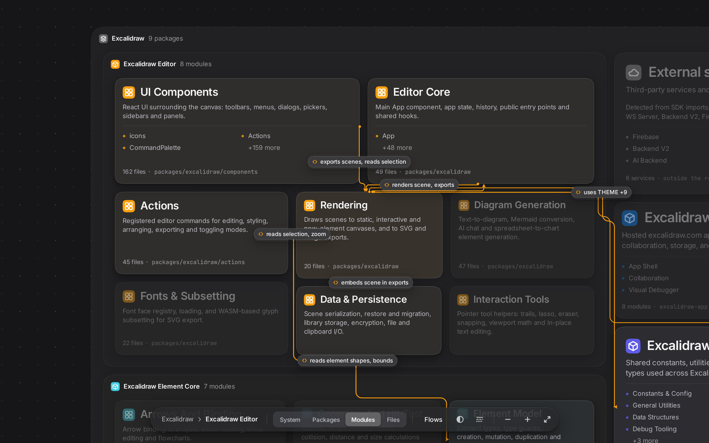
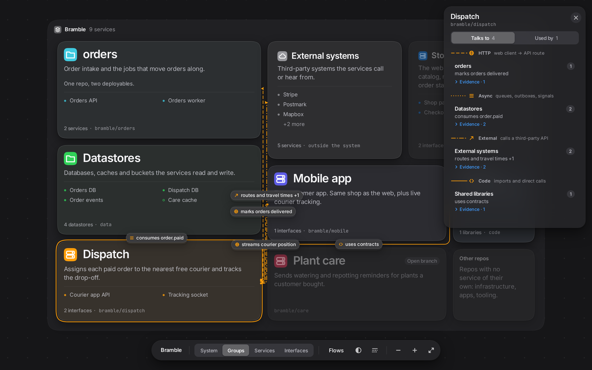
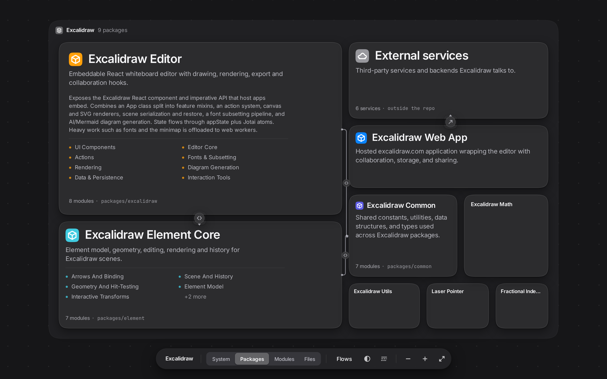

# Loupe

**Zoomable architecture maps for codebases and multi-repo systems.**

Loupe turns a repository, or a whole system of repos, into one self-contained HTML file. You can zoom from "what is this system" down to a single file. Cards open as you zoom in: the system shows its packages, packages show their modules, and modules show their files. Each level explains itself in plain sentences. Typed connections show how the parts talk to each other: HTTP, async jobs, data, third-party APIs, webhooks and code imports. Every connection links to the line of source that proves it. Guided flows walk through the main things the system does, step by step.


<table>
<tr>
<td></td>
<td></td>
</tr>
<tr>
<td></td>
<td></td>
</tr>
</table>

Try it: open [`demo/excalidraw/excalidraw.html`](demo/excalidraw/excalidraw.html), a map of [Excalidraw](https://github.com/excalidraw/excalidraw), or [`examples/bramble/bramble.html`](examples/bramble/bramble.html), a fictional multi-repo system. Download either file and open it in a browser; it needs no server and no network.

## How to read a map

- **Scroll or pinch** to zoom. Drag to pan. **Double-click** a card to fly into it.
- **Hover** a card to light up what it talks to. **Click** it to open the inspector, which lists every connection with its evidence.
- **Esc** or a breadcrumb takes you back out. The level switcher jumps straight to System, Packages, Modules or Files.
- **Flows** plays a guided tour. **Legend** explains the line styles. The **◐** button cycles between System, Light and Dark appearance.

## Quickstart

Run it inside any git repo (Node 18 or later):

```sh
cd your-app
npx @arjanj/loupe
```

That one command scans the code, groups files into modules, writes the descriptions, finds the connections and flows, renders the map and opens it in your browser:

```
loupe · mapping /home/you/your-app
✓ Model  Claude Code · Default
backend: claude (Claude Code CLI, default model)
[1/3] scanning structure + describing code …
[2/3] finding relationships + flows …
[3/3] rendering …
✓ wrote architecture.html (412.6 KiB, 87 nodes) — opening in your browser
```

- **Output:** `architecture.html` in the repo root, one self-contained file.
- **Working files:** `.loupe/` in the repo holds the tree (`.loupe/tree.json`) and the answer cache (`.loupe/cache/`). Loupe writes `.loupe/.gitignore` so none of it is committed; you can also add `.loupe/` to your own `.gitignore`. Answers are keyed by prompt, and prompts include the code, so a rerun only pays for what changed.
- **Model:** Loupe needs one of these, and (unless you pick one) uses the first it finds:
  1. **`claude`** — [Claude Code](https://docs.anthropic.com/en/docs/claude-code) installed and signed in (the `claude` CLI on your `PATH`). Loupe runs it headless with tools disabled.
  2. **`anthropic`** — `ANTHROPIC_API_KEY` set: the Anthropic Messages API.
  3. **`openai`** — `OPENAI_API_KEY` set: the OpenAI Chat Completions API.

  With none of them, Loupe explains the options and exits before doing any work.

**Choosing the model.** In a terminal, Loupe first asks which model to use, listing only what is set up on your machine. Use ↑↓ (or j/k) and Enter; Esc cancels. It preselects your last choice for that repo (kept in `.loupe/config.json`):

```
Which model should describe your code?

  Claude Code · your subscription
  ❯ ● Default            Claude Code's own default
    ○ Sonnet             fast, balanced
    ○ Opus               most thorough
    ○ Haiku              fastest

  Anthropic API · ANTHROPIC_API_KEY
    ○ claude-sonnet-5-5  $2/$10 per MTok · fast, balanced
    ○ claude-opus-5-5    $4/$20 · thorough — current default
    ○ claude-haiku-5-5   from $0.10/$0.50 · fastest, cheapest

  ↑↓ move · enter select · esc cancel
```

It never asks in CI, when input or output isn't a terminal (or `TERM=dumb`), or when you pass `--backend`/`--model` (or set `LOUPE_BACKEND`/`LOUPE_MODEL`); then it uses the automatic choice above.

```sh
npx @arjanj/loupe [map] [repoDir] [options]   # repoDir defaults to the current directory
  --out <file>        write the map somewhere else (relative to the current directory)
  --no-open           don't open the browser (also skipped when CI or LOUPE_NO_OPEN is set, or output isn't a terminal)
  --backend <name>    claude | anthropic | openai, instead of the automatic choice
  --model <name>      claude: an alias like sonnet, opus or haiku; API backends: a model id like claude-sonnet-5-5
  --verbose           show every model call
```

The first map of a mid-size monorepo (around 500 source files) takes tens of minutes.

### Step by step

The one-command flow runs these steps. Run them yourself to control where files go, or to map a system of many repos.

```sh
git clone https://github.com/ArjanJ/loupe && cd loupe && npm install

# a single repo (a monorepo with npm/yarn/pnpm workspaces, or a plain package)
git clone --depth 1 https://github.com/you/your-app input/your-app
node bin/loupe.mjs scan input/your-app maps/your-app.tree.json        # structure + descriptions (model)
node bin/loupe.mjs relations input/your-app maps/your-app.tree.json   # typed connections + flows
node bin/loupe.mjs render maps/your-app.tree.json                     # -> maps/your-app.html

# a system of many repos, from a YAML manifest (no LLM needed)
node bin/loupe.mjs manifest examples/bramble/manifest.yaml
node bin/loupe.mjs render examples/bramble/manifest.tree.json
```

`scan` and `relations` accept `--backend` and `--model` too. Here answers are cached in `.loupe-cache/` next to the output.

| Variable | Default | Meaning |
| --- | --- | --- |
| `LOUPE_BACKEND` | automatic | `claude`, `anthropic` or `openai`; same as `--backend` |
| `ANTHROPIC_API_KEY` | unset | enables the `anthropic` backend |
| `OPENAI_API_KEY` | unset | enables the `openai` backend |
| `ANTHROPIC_BASE_URL` | `https://api.anthropic.com` | API base URL, for proxies and gateways |
| `OPENAI_BASE_URL` | `https://api.openai.com/v1` | API base URL, for proxies and OpenAI-compatible servers |
| `LOUPE_CLAUDE_BIN` | `claude` | path to the Claude Code CLI |
| `LOUPE_MODEL` | `claude`: the CLI's default; `anthropic`: `claude-opus-5-5`; `openai`: `gpt-4.1` | model to use; same as `--model` (the flag wins) |
| `LOUPE_EFFORT` | backend default | `claude`: passed as `--effort`; `anthropic`: `output_config.effort` |
| `LOUPE_CONCURRENCY` | `6` | parallel model calls |
| `LOUPE_KEY_FILES` | `12` | files described per module; the rest become "+N more" |
| `LOUPE_IGNORE` | none | regex of paths to leave out, e.g. `^(examples\|docs)/` |
| `LOUPE_CACHE` | `map`: `<repo>/.loupe/cache`; `scan`/`relations`: `<output dir>/.loupe-cache` | answer cache |
| `LOUPE_NOLLM` | unset | `relations` only: use cached answers, skip new LLM calls |
| `LOUPE_NO_OPEN` | unset | never open the browser |
| `LOUPE_VERBOSE` | unset | same as `--verbose` |

API keys are only sent to their API; Loupe never prints them, and redacts them from error messages.

## What Loupe detects

`loupe relations` reads the code statically; no LLM is involved in finding connections.

- **Code:** runtime imports between files, including workspace packages and `@/` aliases. Type-only imports are skipped.
- **HTTP:** Express, Fastify, Hono and Koa-style routes, plus Next.js route handlers and `pages/api`. These are matched to the `fetch`/`axios`/`ky` calls that hit them.
- **Data:** Prisma model reads and writes, and Drizzle table access.
- **Async:** BullMQ, pg-boss and Inngest producers and consumers, paired by queue or event name. Also web workers.
- **External:** well-known SDKs (GitHub, Stripe, Slack, OpenAI, Anthropic, AWS, Google Cloud, Firebase, Supabase, Sentry and more), literal API hosts, and backends configured by `*_URL` environment variables.
- **Webhooks:** routes under `/webhook(s)`.

The model then labels the rolled-up connections ("renders the scene") and proposes a few end-to-end flows. Loupe checks each flow step against the connections it detected.

## Multi-repo systems

When a system spans many repos, describe it in a [system manifest](docs/manifest.md): services, datastores, external systems, shared libraries, the calls between them, and flows. Each item can carry a lifecycle status (built, branch, proposed, planned) and a confidence level. The map draws work that isn't built yet as ghosted, dashed cards and edges, and tags inferred facts. A service can also drill down into a full per-repo map. See [`examples/bramble/manifest.yaml`](examples/bramble/manifest.yaml).

## Privacy

Everything runs on your machine except the model. `scan` and `relations` send source excerpts and file paths to the backend you use (Claude through your Claude Code CLI, or the Anthropic or OpenAI API); nothing else leaves your machine. A rendered map embeds file paths, short code snippets as evidence, and the generated descriptions. Treat a map of a private repo as private: `input/`, `.loupe/`, `.loupe-cache/` and `private/` are gitignored here for that reason.

## Repository layout

| Path | What |
| --- | --- |
| `bin/loupe.mjs` | the CLI: `map` (the default), `scan`, `relations`, `manifest`, `render` |
| `src/` | one-command flow, model backends, generator, relationship analysis, manifest converter, renderer |
| `viewer/template.html` | the viewer: vanilla Canvas 2D, no dependencies |
| `viewer/fonts/` | Inter and JetBrains Mono subsets (SIL OFL 1.1), embedded at render time |
| `docs/` | [manifest schema](docs/manifest.md), [tree format](docs/tree-format.md), screenshots |
| `examples/bramble/` | a fictional multi-repo system |
| `demo/excalidraw/` | a map of Excalidraw (MIT), generated by Loupe |
| `test/` | the pipeline test (stub models, no network), browser acceptance checks, an escaping test, the screenshot script (need Playwright) |

## Tests

```sh
npm i -D playwright && npx playwright install chromium
node test/pipeline.mjs                                     # one-command flow against stub models (no Playwright, no network)
npm test                                                   # pipeline + escaping + acceptance on the example
SCHEME=dark node test/acceptance.mjs demo/excalidraw/excalidraw.html
npm run screenshots
```

## License

MIT © 2026 Arjan Jassal. The embedded fonts are under the SIL Open Font License. The demo is a map of Excalidraw, which is MIT licensed; it is not affiliated with that project. See [THIRD_PARTY_NOTICES.md](THIRD_PARTY_NOTICES.md).
